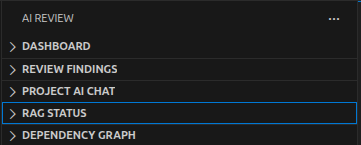
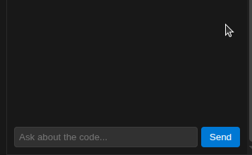
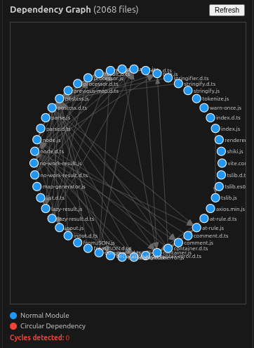
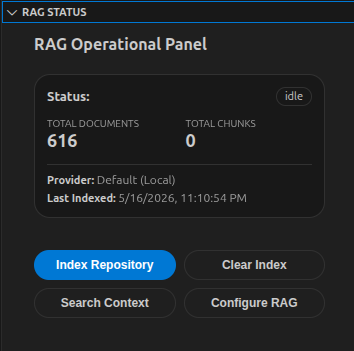

# AI Code Review (Beta)

AI-powered code review with Human-in-the-Loop validation,
local-first execution, contextual RAG analysis, and enterprise-grade runtime hardening.

Designed for developers who want AI assistance without losing control over the review process.

---

## 🚀 Key Features

- **HITL Workflow (Human-in-the-Loop)**  
  Approve or reject AI findings before they become diagnostics in your editor.

- **Context-Aware Analysis (RAG)**  
  Uses Retrieval Augmented Generation to understand your repository structure, architecture, and code patterns.

- **Project AI Chat**  
  Chat with your codebase using contextual repository knowledge.

- **Local-First AI**  
  Run fully offline using Ollama and local repository indexing.

- **Advanced Quality Metrics**  
  Automatic detection of:
  - SOLID violations;
  - Cognitive Complexity;
  - Testability issues;
  - Architecture smells.

- **Smart Fix (AI Refactoring)**  
  Generate and apply AI-assisted code fixes directly from findings.

- **PR Summary Generator**  
  Automatically generate detailed Pull Request summaries.

- **Multi-Provider Support**
  - Ollama
  - OpenAI
  - Gemini
  - Claude

- **Privacy & Security**
  - Data masking for secrets and PII;
  - Secure credential storage via VS Code SecretStorage;
  - Runtime validation and hardened AI parsing.

- **Cloud Sync (VPS)**
  Synchronize review sessions and findings across machines.

- **Multi-Language (Beta)**
  Structural analysis support for:
  - TypeScript
  - Python
  - Go

---

## 🛡 Reliability

Built with production-grade runtime hardening:

- Runtime diagnostics validation
- Automated E2E testing
- Defensive AI response validation with Zod
- Automatic retries and timeout handling
- Dependency and architecture validation
- Hardened Extension Host lifecycle
- Runtime wiring validation
- Circular dependency detection

---

## 📸 Screenshots

### AI Review Sidebar



### Project AI Chat



### Dependency Graph



### RAG Status



---

## ❓ Why AI Code Review?

Unlike traditional AI review tools, AI Code Review was designed with:

- Human-in-the-Loop validation;
- local-first execution with Ollama;
- contextual repository understanding (RAG);
- runtime hardening and defensive validation;
- privacy-first architecture;
- persistent Git-based review sessions;
- actionable findings instead of noisy suggestions.

The reviewer always remains in control.

---

## 🛠 Quick Start

1. Install the extension.
2. Run:
   ```txt
   Code Review: Set AI Provider
   ````
3. Configure:

   * Ollama;
   * OpenAI;
   * Gemini;
   * or Claude.
4. Run:

   ```txt
   Code Review: Setup RAG
   ```
5. Open the **AI Review Sidebar**.
6. Analyze the current file:

   * `Ctrl + Alt + R`
   * `Cmd + Alt + R` on macOS.
7. Review findings.
8. Approve or reject diagnostics.
9. Generate PR summaries before pushing changes.

> Tip: Check the QUICKSTART.md guide for a full 5-minute onboarding walkthrough.

---

## ⚙️ Configuration

Settings use the `codeReview` namespace.

| Setting                         | Default | Description                                    |
| ------------------------------- | ------- | ---------------------------------------------- |
| `codeReview.provider`           | `mock`  | `mock`, `ollama`, `openai`, `gemini`, `claude` |
| `codeReview.rag.enabled`        | `true`  | Enable repository context enrichment           |
| `codeReview.privacy.maskData`   | `true`  | Automatically mask PII and secrets             |
| `codeReview.autoRevalidate`     | `false` | Re-run analysis automatically on save          |
| `codeReview.autoRestoreSession` | `true`  | Restore review sessions on branch switch       |

---

## ✅ Compatibility

Supported environments:

* VS Code Stable
* VS Code Insiders
* Linux
* macOS
* Windows

---

## 📖 Documentation

* `QUICKSTART.md` → 5-minute onboarding
* `TROUBLESHOOTING.md` → Common issues and fixes
* `CHANGELOG.md` → Release history
* `docs/` → Architecture and technical documentation

---

## 🧪 Quality & Testing

The project includes:

* Unit Tests
* Integration Tests
* E2E Tests
* Runtime Diagnostics
* RAG Pipeline Validation
* LLM Contract Tests
* Mutation Testing
* Architecture Validation
* Dependency Rules Enforcement

---

## 🔒 Privacy First

AI Code Review was designed to work safely in enterprise and local-first environments.

Features include:

* local Ollama execution;
* local repository indexing;
* data masking;
* secure credential storage;
* defensive runtime validation.

---

## 📌 Status

🟢 **Production-Ready Beta for VS Code**

Core runtime, AI integration, RAG pipeline, diagnostics, and packaging are validated through automated quality gates and runtime diagnostics.

---

## ❤️ Contributing

Contributions, bug reports, feature requests, and discussions are welcome.

---

## 📄 License

MIT
