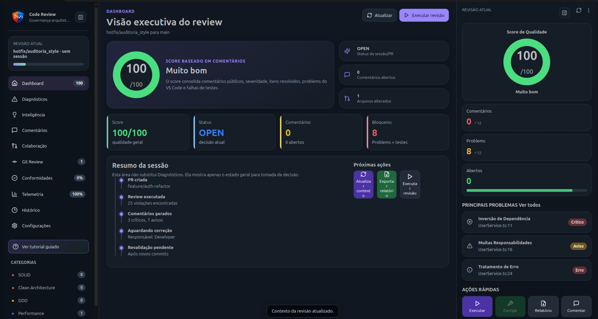
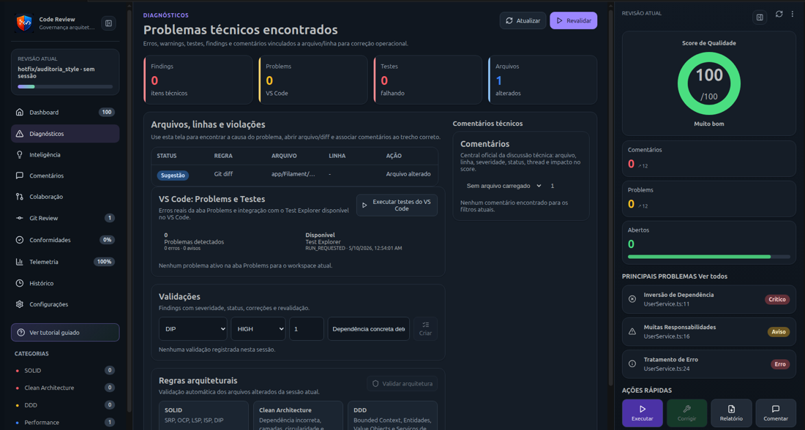

# Git Code Review

**Enterprise-ready code review for reviewers, inside your IDE.**

Git Code Review is an Enterprise-ready code review governance workspace for VS Code. It helps **code reviewers** review changes with Git context, Human-in-the-Loop findings, local-first RAG, AI assistance, Team collaboration foundations, Enterprise governance, diagnostics, quality score and review sessions.

The AI assists the review process, but the final decision always belongs to the reviewer.



## Why Git Code Review?

| Problem | How Git Code Review helps |
|---|---|
| Reviews are scattered across IDE, Git and chat | Centralizes findings, comments, diagnostics and Git context inside VS Code |
| AI suggestions can be unsafe | Uses Human-in-the-Loop: reviewers approve, reject or reply |
| Reviewers lose repository context | Uses RAG to index repository context locally or through configured providers |
| Teams lack review consistency | Provides score, categories, reports and plan-based product packaging |
| Production readiness is hard to verify | Includes Product Diagnostics and VSIX validation gates |

## Core workflow

```text
Start Review
  ↓
Run Product Diagnostics
  ↓
Configure provider or use Mock/Ollama
  ↓
Index Repository RAG
  ↓
Analyze Workspace / Branch / Current File
  ↓
Review Findings
  ↓
Approve / Reply / Refactor / Generate Report
```

## Main features

| Feature | Description |
|---|---|
| Start Review | Product entrypoint for the reviewer workflow |
| Dashboard | Review readiness, active plan, provider, RAG and quality score |
| Product Diagnostics | Checks workspace, Git, AI provider, RAG and extension container |
| Findings | Human-reviewed technical findings with severity and confidence |
| Git Review | Analyze current file, workspace, branch commits and pull requests |
| RAG | Index repository context for better AI-assisted review |
| Project AI Chat | Ask questions about the codebase with contextual knowledge |
| PR Summary | Generate review-ready pull request summaries |
| Quality Report | Generate technical quality reports |
| Local-first | Works with Mock and Ollama without requiring cloud |
| Local Sessions | Persists review sessions by branch so findings survive reloads |
| Safe Refactor Preview | Shows a diff before applying AI-generated fixes |
| Markdown Export | Exports a local HITL review report for reviewers and PRs |
| Cloud Provider Setup | Configures OpenAI, Gemini, Claude or a custom cloud provider for Pro workflows |
| Provider Health Test | Validates the active AI provider before review/report generation |
| PDF Export | Exports a shareable technical quality report as PDF |
| Review Templates | Focuses review on general, security, architecture, Laravel, React, API, performance or testability concerns |
| Review History | Opens previous local review sessions by branch |


## Enterprise Ready 4.0 workflow

```text
Open Provider Setup
  ↓
Open RAG Manager / Project Chat
  ↓
Open Dependency Graph
  ↓
Open Review Intelligence
  ↓
View Plans and Packaging
  ↓
Open Team Dashboard
  ↓
Open Enterprise Governance
```

Version 4.0.3 consolidates the roadmap from Pro UX Polish to Enterprise Foundation. It adds visual product workspaces for provider setup, RAG management, reports, dependency graph, plans, team collaboration, audit logs, SSO/RBAC configuration, AI policies and self-hosted readiness.

## Pro Foundation workflow

```text
Configure Cloud Provider
  ↓
Test AI Provider Connection
  ↓
Select Review Template
  ↓
Generate AI PR Summary
  ↓
Generate Technical Quality Report
  ↓
Export PDF report
```

The Pro Foundation workflow is designed for professional code reviewers who need cloud AI, advanced PR summaries, technical quality reports, PDF artifacts and reusable review templates.

## Community Stable workflow

```text
Start Review
  ↓
Safe workspace analysis
  ↓
Local review session is persisted by branch
  ↓
Reviewer approves, replies, copies or previews refactors
  ↓
Revalidate after code changes
  ↓
Export Markdown report
```

The Community plan is designed to be useful without login, billing, cloud sync or managed infrastructure.

## Product plans

| Plan | Audience | Purpose |
|---|---|---|
| Community | Individual code reviewers | Free local-first adoption |
| Pro | Professional code reviewers | Cloud AI, productivity, reports and advanced history |
| Team | Squads and teams | Shared sessions, collaboration and review standards |
| Enterprise | Organizations | SSO, audit logs, RBAC, AI governance and self-hosted options |

## Quickstart

1. Install the extension.
2. Open the **Code Review** activity bar.
3. Run **Code Review: Start Review**.
4. Run **Code Review: Run Product Diagnostics**.
5. Use the default Mock provider, configure Ollama, or set a cloud provider.
6. Run **Code Review: Index Repository RAG**.
7. Run **Code Review: Analyze Workspace** or **Code Review: Analyze Branch Commits**.
8. Review findings and decide what to approve, reply, copy or refactor.

## Recommended commands

| Command | Purpose |
|---|---|
| Code Review: Start Review | Main entrypoint |
| Code Review: Guided Setup | Configure provider and RAG |
| Code Review: Setup Ollama Local AI | Configure and validate Ollama for Community local-first usage |
| Code Review: Run Product Diagnostics | Validate environment and runtime |
| Code Review: Analyze Workspace | Analyze the current workspace |
| Code Review: Analyze Branch Commits | Analyze branch changes |
| Code Review: Index Repository RAG | Build repository context |
| Code Review: Generate AI PR Summary | Generate pull request summary |
| Code Review: Generate Technical Quality Report | Generate quality report |
| Code Review: Revalidate Current Review Session | Re-check findings after code changes while preserving decisions |
| Code Review: Export Review as Markdown | Export the current branch review session as Markdown |
| Code Review: Configure Cloud AI Provider | Configure OpenAI, Gemini, Claude or a custom endpoint for Pro workflows |
| Code Review: Test AI Provider Connection | Validate active provider health |
| Code Review: Export Review as PDF | Export the current branch review session as PDF |
| Code Review: Select Review Template | Select the focus for the next review |
| Code Review: Open Review History | Inspect local review sessions by branch |
| Code Review: View Pro Features | Open the Pro Foundation feature overview |
| Code Review: Open Provider Setup | Visual setup for Mock, Ollama and cloud providers |
| Code Review: Open RAG Manager | Manage local RAG indexing and context search |
| Code Review: Open Project Chat | Focus the Project Chat view |
| Code Review: Open Dependency Graph | Focus the dependency graph view |
| Code Review: Open PR Summary Workspace | Visual PR Summary workspace |
| Code Review: Open Quality Report Workspace | Visual Quality Report workspace |
| Code Review: Open Review Intelligence | Reports, history and decision intelligence |
| Code Review: View Plans and Packaging | Compare Community, Pro, Team and Enterprise |
| Code Review: Configure License Plan | Select active local plan |
| Code Review: Start Pro Trial | Enable local 14-day Pro trial |
| Code Review: Open Team Dashboard | Team collaboration foundation |
| Code Review: Export Shared Review Session | Export current session as JSON |
| Code Review: Manage Review Policies | Configure local team review policies |
| Code Review: Open Collaboration Center | Team collaboration workflow |
| Code Review: Open Enterprise Governance | SSO, RBAC, audit, AI policies and self-hosted readiness |
| Code Review: Configure SSO | Configure local SAML/OIDC metadata |
| Code Review: Configure RBAC | Configure local Enterprise role |
| Code Review: Open Audit Logs | Show governance audit logs |
| Code Review: Export Audit Logs | Export audit logs as JSON |
| Code Review: Configure AI Policies | Configure Enterprise AI usage policies |
| Code Review: Prepare Self-hosted Bundle | Generate self-hosted readiness document |


## Local-first providers

| Provider | Use case |
|---|---|
| Mock | Safe offline fallback and demos |
| Ollama | Local AI without cloud dependency |
| OpenAI / Gemini / Claude | Optional cloud AI for Pro/Team/Enterprise workflows |

## Diagnostics



Run:

```text
Code Review: Run Product Diagnostics
```

Diagnostics validates:

- product audience and plan;
- workspace;
- Git branch;
- AI provider;
- RAG provider;
- required use cases in the extension container.

## Privacy and control

- The reviewer remains in control.
- The extension defaults to a safe local/offline fallback.
- Local-first usage is supported through Mock and Ollama.
- Code sent to cloud providers depends on explicit provider configuration.
- Human approval is required for review decisions.

## Production gate

Before publishing or shipping a release, run:

```bash
npm run product:release
```

This validates typecheck, production tests, build, VSIX packaging, VSIX contents, product readiness and critical audit.

## Documentation

| Document | Purpose |
|---|---|
| `docs/PRICING_AND_PACKAGING.md` | Plans, limits and monetization |
| `docs/product/PRODUCT_POSITIONING.md` | Product positioning and messaging |
| `docs/product/PRODUCT_REQUIREMENTS.md` | Product requirements and DoD |
| `docs/product/MARKETPLACE_LISTING.md` | Marketplace copy and release listing |
| `docs/product/ONBOARDING_FLOW.md` | First-use journey |
| `docs/product/PRO_UX_POLISH.md` | 2.6.0 visual product UX |
| `docs/product/RAG_PROJECT_CHAT.md` | 2.7.0 RAG and Project Chat |
| `docs/product/DEPENDENCY_GRAPH.md` | 2.8.0 Dependency Graph |
| `docs/product/REPORTS_AND_INTELLIGENCE.md` | 2.9.0 Reports and intelligence |
| `docs/product/PRO_COMMERCIAL.md` | 3.0.0 Pro Commercial |
| `docs/team/TEAM_FOUNDATION.md` | 3.1.0 Team Foundation |
| `docs/enterprise/ENTERPRISE_FOUNDATION.md` | 4.0.3 Enterprise Foundation |
| `PRODUCT_READY_REPORT_4_0_0.md` | Release readiness report for 4.0.3 |


## 4.0.3 Design Workspace

This release adds a full editor-area Code Review Workspace aligned with the product wireframe. Use `Code Review: Start Review` or `Code Review: Open Code Review Workspace` to operate the main flow outside the narrow sidebar.

## 5.0.2 Dependency Graph Fix

The Dependency Graph central workspace now uses the same dependency analysis data as the sidebar preview. It supports hover tooltips, package/file scope, import/cycle filters, and clicking nodes to open the related file. Package nodes open a file picker for files inside that package.
